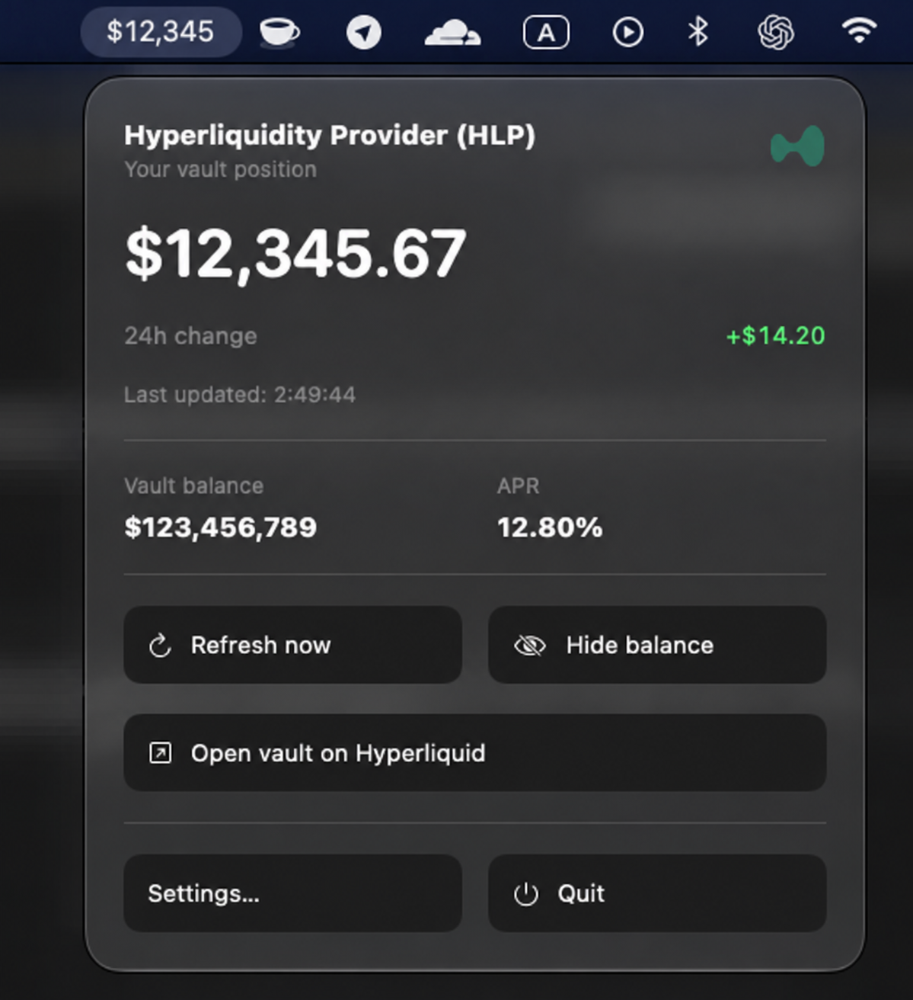
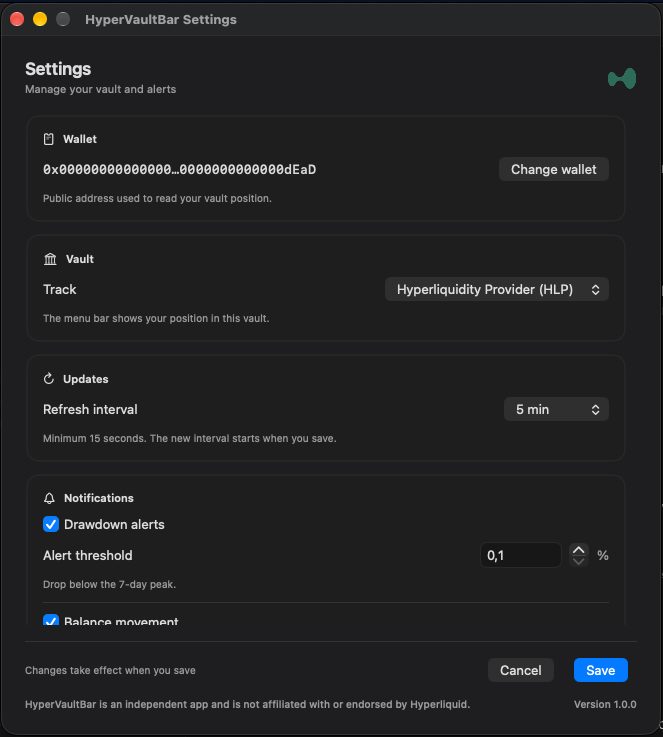

# HyperVaultBar

A native macOS menu bar app for monitoring your position in Hyperliquidity Provider (HLP) or any Hyperliquid vault. Built with SwiftUI, with no third-party dependencies or API key required.

## Screenshots

**Menu bar popup** — Click the balance in the menu bar to view your position, 24-hour change, vault balance, and APR.



**Settings** — Choose a vault and refresh interval, then configure alerts and appearance.



The screenshots use a placeholder wallet address and sample financial values.

## Features

- Personal vault balance and 24-hour percentage change in the menu bar.
- Vault balance, APR, and last update time in the popup.
- Optional alerts for balance movements, APR changes, and drawdowns from the seven-day high.
- Configurable refresh interval, launch at login, balance hiding, and reduced transparency.

## Build and run

Requires macOS 26 or later and Xcode with a compatible macOS SDK.

1. Open `HyperVaultBar.xcodeproj` in Xcode.
2. Select the **HyperVaultBar** scheme and configure your signing team and bundle identifier.
3. Build and run. HyperVaultBar appears in the menu bar.
4. Open **Settings**, enter your public wallet address, select a vault, and save.

Right-click the menu bar balance for **Refresh**, **Hide Balance** or **Show Balance**, **Settings**, and **Quit**.

When the balance is hidden, the menu bar shows a crossed-out eye.

To update a saved address, use **Change wallet**, confirm with **Change**, then save.

Refresh defaults to 15 minutes, with a minimum of 15 seconds. The app refreshes immediately when the Mac wakes. Notifications require permission and are checked on each refresh. Install the signed app in `/Applications` before enabling launch at login.

## Data and privacy

The app only needs your public wallet address to read publicly available wallet and vault data from Hyperliquid's `/info` API. It never requests your seed phrase or private key. Preferences and history are stored locally, with history separated by wallet and vault.

The 24-hour comparison requires local history. Percentage changes below 0.1% in magnitude are hidden, while the popup still shows the dollar change. Deposits and withdrawals are excluded when verified transaction data is available. When it is unavailable, the app shows **24h balance change** and pauses balance-based alerts.

The vault-wide balance is a sampled value. Network failures preserve the last known balance in the popup and mark it as stale. Movement alerts require a full comparison window of local history, and detection follows the refresh interval.

## Tests

```sh
xcodebuild test -project HyperVaultBar.xcodeproj \
  -scheme HyperVaultBarTests -configuration Debug \
  -destination 'platform=macOS' \
  -derivedDataPath /private/tmp/HyperVaultBarDerived \
  CODE_SIGN_IDENTITY=- CODE_SIGNING_REQUIRED=NO
```

Architecture and maintenance instructions are in [AGENTS.md](AGENTS.md).

## License

Code is available under the [MIT License](LICENSE). The Hyperliquid name and logo belong to their respective owners and are excluded from this license.

---

HyperVaultBar is independent and is not affiliated with or endorsed by Hyperliquid. The bundled Hyperliquid mark is sourced from [Logos and Types](https://logosandtypes.com/wp-content/uploads/2024/12/hyper-foundation.svg).
